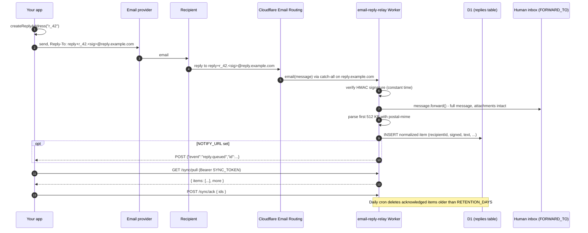

# email-reply-relay

A Cloudflare Worker that turns [Cloudflare Email Routing](https://developers.cloudflare.com/email-routing/) into a reply inbox for an app that sends email. Your app sends mail through any provider (SendGrid, SES, Postmark, SMTP...) with a signed, per-recipient `Reply-To` such as `reply+r_42.3f9c0a1b2c3d4e5f@reply.example.com`. When someone replies, the Worker checks the signature, forwards the original message to a human inbox with its attachments, and puts a parsed, normalized copy in a D1 queue. Your app pulls that queue over an authenticated HTTP API whenever it likes, so it needs no public endpoint, no IMAP and no inbound-parse webhook.

## How it works



## Features

- **Signed reply addresses.** `reply+<recipientId>.<sig>@<REPLY_DOMAIN>`, where `sig` is the first `SIGNATURE_LENGTH` (default 16) hex characters of `HMAC-SHA256(REPLY_SECRET, "reply|<recipientId>")`. Verified with a constant-time comparison.
- **Nothing is lost.** Every message to the reply domain is forwarded to `FORWARD_TO` with `message.forward`, so attachments and the original headers arrive untouched. If forwarding fails, the item is still queued and the error is recorded on it.
- **Unsigned mail is kept too.** Mail sent to any other address on the reply domain (someone typed `reply@...`, or a client mangled the address) is forwarded and queued with `signed: false` and no recipient id, so the app can match it by sender if it wants. Mail for any other domain is rejected with `setReject`.
- **Bounded parsing.** Only the first 512 KB is parsed with [postal-mime](https://github.com/postalsys/postal-mime). Text and HTML bodies are capped at 200,000 characters each. The item records `truncated` and the attachment names it saw.
- **Pull queue over HTTP.** `GET /sync/pull` and `POST /sync/ack`, protected by a bearer token. Items are returned until acknowledged, so delivery is at-least-once.
- **Retention.** A cron trigger deletes acknowledged items after `RETENTION_DAYS`. Unacknowledged items are never deleted automatically.
- **Optional webhook.** `NOTIFY_URL` gets a content-free ping when a reply is queued, so the app can pull straight away instead of polling.
- **Node helper.** [`client/replyAddress.js`](client/replyAddress.js) creates and verifies addresses in the sending app, with no dependencies. A pull-loop example is in [`client/pull-loop.example.js`](client/pull-loop.example.js).

## Why signed addresses

A single shared `Reply-To` (say `replies@example.com`) tells you nothing about which message or recipient a reply belongs to. You end up matching on the sender address, which breaks as soon as someone replies from a different account, or on `In-Reply-To` headers, which some clients drop.

Putting an id in the address fixes that, but an unsigned id has two problems:

- **Guessing and spoofing.** Anyone can send mail to `reply+r_43@...` and have it attributed to recipient `r_43`. With an HMAC in the address, only addresses your app actually generated verify. A sender would need the secret to produce one for an id they were not sent.
- **State.** The usual alternative is a random token per message plus a lookup table mapping tokens to recipients. A signed id carries its own proof, so the Worker needs no mapping table and no access to your app's database. It checks the signature and passes the id through.

The signature is truncated to keep addresses readable. At the default 16 hex characters it is 64 bits, far more than an attacker can brute-force by sending email. You can raise `SIGNATURE_LENGTH` (up to 64) if you prefer.

Note what the signature does **not** prove: it shows the address came from your app, not that the person replying is the original recipient. A forwarded email keeps its `Reply-To`, so anyone it was forwarded to can reply to the same address. Treat `recipientId` as "this is a reply in recipient r_42's thread", not as authentication of the sender.

## Setup

You need a Cloudflare account with a domain on it (`example.com` below) and Node 22.13 or newer.

1. **Install.**

   ```sh
   npm ci
   cp wrangler.toml.example wrangler.toml
   ```

2. **Create the D1 database and apply the schema.**

   ```sh
   npx wrangler d1 create email-reply-relay
   # paste the printed database_id into wrangler.toml
   npm run db:init          # = wrangler d1 execute email-reply-relay --remote --file schema.sql
   ```

3. **Set the variables** in `wrangler.toml`: `REPLY_DOMAIN` (for example `reply.example.com`), `FORWARD_TO`, and optionally `RETENTION_DAYS`, `SIGNATURE_LENGTH` and `NOTIFY_URL`.

4. **Set the secrets.** Generate two long random values, for example with `openssl rand -hex 32`.

   ```sh
   npx wrangler secret put REPLY_SECRET   # also give this to the sending app
   npx wrangler secret put SYNC_TOKEN     # the app sends it as "Authorization: Bearer ..."
   ```

5. **Deploy.**

   ```sh
   npm run deploy
   ```

6. **Enable Email Routing on the reply subdomain.** In the Cloudflare dashboard, under *Email > Email Routing*:
   - Enable Email Routing for the zone if it is not already, then add the subdomain (`reply.example.com`) under *Settings*. Cloudflare adds the MX and SPF records for it; let it, or add the records it shows you. Using a dedicated subdomain leaves the main domain's mail setup alone.
   - Under *Destination addresses*, add and verify the `FORWARD_TO` address. `message.forward` only delivers to verified destinations.
   - Under *Routing rules*, set the **catch-all** for the subdomain to *Send to a Worker* and pick `email-reply-relay`.

7. **Send a test.** Create an address with the helper (below), send yourself an email with that `Reply-To`, reply to it, and check that it arrives at `FORWARD_TO` and that `GET /sync/pull` returns it.

### Configuration reference

| Name | Kind | Required | Purpose |
| --- | --- | --- | --- |
| `REPLY_SECRET` | secret | yes | HMAC key for reply addresses. Same value in the sending app. |
| `SYNC_TOKEN` | secret | yes | Bearer token for `/sync/*`. |
| `REPLY_DOMAIN` | var | yes | The reply subdomain, e.g. `reply.example.com`. Matched exactly, not including subdomains. |
| `FORWARD_TO` | var or secret | recommended | Verified destination that receives every reply. Without it items are only queued. |
| `RETENTION_DAYS` | var | no | Days to keep acknowledged items. Default `7`. |
| `SIGNATURE_LENGTH` | var | no | Hex chars of HMAC in the address, 8-64. Default `16`. |
| `NOTIFY_URL` | var | no | URL to POST to when an item is queued. |
| `DB` | D1 binding | yes | The `replies` table from `schema.sql`. |

## Pull API

All `/sync/*` requests need `Authorization: Bearer <SYNC_TOKEN>`. A missing or wrong token gets `401`. If `SYNC_TOKEN` is not configured the endpoints answer `503`.

### `GET /sync/pull?limit=50`

Returns unacknowledged items, oldest first. `limit` defaults to 50 and is capped at 100. `more` is `true` when further items are waiting.

```json
{
  "items": [
    {
      "id": 17,
      "receivedAt": "2026-11-02T10:00:03.512Z",
      "recipientId": "r_42",
      "signed": true,
      "envelope": { "from": "jane@example.org", "to": "reply+r_42.3f9c0a1b2c3d4e5f@reply.example.com" },
      "from": { "name": "Jane Doe", "address": "jane@example.org" },
      "to": [{ "name": "", "address": "reply+r_42.3f9c0a1b2c3d4e5f@reply.example.com" }],
      "cc": [],
      "replyTo": [],
      "subject": "Re: Your order",
      "date": "2026-11-02T10:00:00.000Z",
      "messageId": "<reply-1@example.org>",
      "inReplyTo": "<original-1@example.com>",
      "references": "<original-1@example.com>",
      "text": "Thanks, that works for me.\n",
      "html": "",
      "attachments": [{ "filename": "invoice.pdf", "mimeType": "application/pdf", "disposition": "attachment" }],
      "rawSize": 1834,
      "truncated": false,
      "parseError": null,
      "forwarded": true,
      "forwardError": null
    }
  ],
  "more": false
}
```

For unsigned mail, `signed` is `false` and `recipientId` is `null`. `envelope.to` still shows the address it was sent to.

### `POST /sync/ack`

```json
{ "ids": [17, 18] }
```

Marks items as delivered so they no longer appear in `/sync/pull`. Up to 500 positive integer ids per call. Unknown or already-acknowledged ids are ignored. The response says how many were newly acknowledged: `{ "acked": 2 }`. Acknowledged items stay in D1 until the cron cleanup removes them.

### `GET /health`

Unauthenticated. Returns `{ "ok": true }`.

### Webhook

If `NOTIFY_URL` is set, the Worker POSTs this after queuing an item:

```json
{ "event": "reply.queued", "id": 17, "signed": true }
```

The body deliberately carries no message content and the request is not authenticated, so treat it only as a hint to call `/sync/pull`. Failures are logged and otherwise ignored.

## Node helper

[`client/replyAddress.js`](client/replyAddress.js) is a dependency-free ES module for the sending app. Copy it into your project or import it from here.

```js
import { createReplyAddress, verifyReplyAddress } from './client/replyAddress.js';

const options = { secret: process.env.REPLY_SECRET, domain: 'reply.example.com' };

const replyTo = createReplyAddress('r_42', options);
// "reply+r_42.<16 hex chars>@reply.example.com" - use it as the Reply-To of the message to r_42

verifyReplyAddress(replyTo, options);                                    // "r_42"
verifyReplyAddress('reply+r_43.0000000000000000@reply.example.com', options); // null
```

Recipient ids must match `/^[a-z0-9_-]{1,64}$/`. They are lowercase because some mail systems change the case of the local part. If your ids are UUIDs or database ids this is usually already true. Otherwise use a lowercase encoding of them. Pass `signatureLength` if you changed `SIGNATURE_LENGTH` on the Worker.

[`client/pull-loop.example.js`](client/pull-loop.example.js) shows a minimal consumer: pull, handle each item, acknowledge the ones that succeeded, repeat.

```sh
RELAY_URL=https://email-reply-relay.<your-subdomain>.workers.dev SYNC_TOKEN=... node client/pull-loop.example.js
```

Because delivery is at-least-once, make your handler idempotent, for example by keying on `id` or `messageId`.

## Security notes

- **Secrets.** `REPLY_SECRET` and `SYNC_TOKEN` should be long random values stored with `wrangler secret put`, not in `wrangler.toml`. Use different values for the two. Rotating `REPLY_SECRET` invalidates every reply address already sent: replies to them will arrive as `signed: false`.
- **Constant-time checks.** Signatures and the bearer token are compared by hashing both sides with SHA-256 and comparing the digests with `crypto.subtle.timingSafeEqual`, so neither content nor length leaks through timing.
- **Unsigned does not mean trusted, and signed does not mean authenticated.** Unsigned items never carry a `recipientId`. Signed items prove only that the address came from your app (see [Why signed addresses](#why-signed-addresses)). The `From` header of any email can be forged. If that matters, check the `Authentication-Results` header in the forwarded copy, or extend the parser to keep it.
- **Message content is untrusted input.** `html` is the raw HTML from the sender. Sanitize it before rendering it anywhere.
- **Rejection.** Only mail for exactly `REPLY_DOMAIN` is accepted. If you also point a main-domain catch-all at this Worker, that mail is rejected, not forwarded.
- **Webhook.** The `NOTIFY_URL` ping contains only an id. Do not act on it except by pulling.
- **Missing configuration.** Without `REPLY_SECRET` or `REPLY_DOMAIN` the email handler throws instead of accepting mail it cannot verify.

## Limits

- **Email Routing.** Cloudflare Email Routing has its own limits, including a maximum message size (25 MiB at the time of writing) and rules about which headers may be added when forwarding. Check the [current limits](https://developers.cloudflare.com/email-routing/limits/) before relying on them.
- **Parse cap.** Only the first 512 KB of each message is parsed (`MAX_PARSE_BYTES` in `src/inbound.js`). For a large message this usually still includes the headers and text, but the body or later attachments may be missing from the queued item. Those items have `truncated: true`. The forwarded copy is always complete.
- **Body cap.** `text` and `html` are each cut at 200,000 characters (`MAX_BODY_CHARS`) so a row stays well within D1's row size limit.
- **Attachments are not stored.** The queue records attachment names and types. The files are in the forwarded copy.
- **Workers limits.** Parsing runs inside the Worker's CPU time limit for your plan. The parse cap exists to keep it there.

## Development

```sh
npm ci
npm test
```

The tests use Node's built-in test runner. The D1 binding is replaced by an in-memory SQLite database (`node:sqlite`) loaded with the real `schema.sql`, and Email Routing messages are small stubs (see `test/helpers.js`). They cover signing and verification on both sides, the signed, unsigned and rejected paths, forward failures, truncation, the pull/ack API and its authentication, and the cron cleanup.

```
src/
  index.js     entry point: email, fetch and scheduled handlers, HTTP routing
  inbound.js   reading, forwarding, parsing and queuing one message
  address.js   reply address classification and signature check
  store.js     D1 queries
  crypto.js    HMAC and constant-time comparison
client/
  replyAddress.js         Node helper for the sending app
  pull-loop.example.js    example consumer
test/                     node --test suites and test doubles
schema.sql                D1 schema
wrangler.toml.example     configuration template
```

## License

[MIT](LICENSE)
